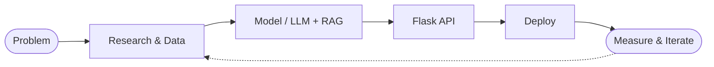

<div align="center">


<a href="https://github.com/RasikhAli">
  
</a>

<br/><br/>

<a href="#about-me"></a>
<a href="#tech-stack"></a>
<a href="#github-metrics"></a>
<a href="#featured-projects"></a>
<a href="#published-research"></a>
<a href="#lets-connect"></a>

<br/><br/>


</div>

<br/>

## About Me

<table width="100%">
<tr>
<td width="58%" valign="top">

I build **intelligent systems that actually ship**: from research-grade NLP models to production Flask backends and real-time AI applications.

A **Gold Medalist in BS Software Engineering**, I work across **Machine Learning, Python, and full-stack web**, and I'm deeply interested in where research meets product: **LLMs, Retrieval-Augmented Generation (RAG), and AI Agents**.

```python
class RasikhAli:
    roles      = ["Software Engineer", "ML Engineer", "Junior Lecturer"]
    education  = "BS Software Engineering (Gold Medalist)"
    strengths  = ["NLP", "Computer Vision", "Flask APIs", "Applied AI"]
    exploring  = ["LLMs", "RAG pipelines", "AI Agents"]
    mindset    = "Build it, measure it, make it scale."

    def current_focus(self):
        return [
            "AI-powered apps built on LLMs",
            "Scalable Flask-based systems",
            "Production-ready AI solutions",
        ]
```

</td>
<td width="42%" valign="top">

<div align="center">

<br/>
<br/>
<br/>
<br/>


</div>

</td>
</tr>
</table>

### How I Build



<br/>

## Tech Stack

<table width="100%">
<tr>
<td width="50%" valign="top">

**Languages**


**AI / Machine Learning**

<br/>
`Machine Learning` `Deep Learning` `NLP` `Computer Vision` `Predictive Analytics` `LLMs` `RAG`

</td>
<td width="50%" valign="top">

**Web & Data**


**Tools & Platforms**


</td>
</tr>
</table>

<br/>

## GitHub Metrics

<sub>Generated by <a href="https://github.com/lowlighter/metrics"><code>lowlighter/metrics</code></a> via <code>.github/workflows/metrics.yml</code> · refreshes daily</sub>

<div align="center">


<br/><br/>

**Overview**


<table width="100%">
<tr>
<td width="50%">

**Recent Activity**


</td>
<td width="50%">

**Community**


</td>
</tr>
<tr>
<td width="50%">

**Repositories**


</td>
<td width="50%">

**Leetcode & Steam**


</td>
</tr>
</table>


</div>

<br/>

## Featured Projects

### AI & Computer Vision

<table width="100%">
<tr>
<td width="50%" valign="top">

#### Face Profiling System
AI-based personality prediction using image processing and facial analysis.

`OpenCV` `Flask` `Python`

<a href="https://github.com/RasikhAli/Bitlogicx/tree/main/7.%20Face%20Profiling"></a>

</td>
<td width="50%" valign="top">

#### Animal Herd Detection & Alert System
Real-time intelligent monitoring system that detects animal herds and generates alerts.

`Python` `OpenCV` `ML`

<a href="https://github.com/RasikhAli/Bitlogicx/tree/main/3.%20AnimalHerd"></a>

</td>
</tr>
</table>

### NLP & Conversational AI

<table width="100%">
<tr>
<td width="50%" valign="top">

#### Hadith Explorer Chatbot
AI-powered chatbot for interactive, intelligent exploration of Hadith collections.

`Python` `Flask` `AI`

<a href="https://hadithbot.marveloussoft.tech/"></a>

</td>
<td width="50%" valign="top">

#### Sarcasm Detection in Headlines
Deep learning model for classifying sarcasm in news headlines.

`Python` `TensorFlow` `NLP`

<a href="https://github.com/RasikhAli/Sarcasm-Detection"></a>

</td>
</tr>
</table>

### Web Platforms & Automation

<table width="100%">
<tr>
<td width="50%" valign="top">

#### Superior Academic Tool
Academic management platform that streamlines timetable processing for students and faculty.

`Python` `Flask` `HTML/CSS`

<a href="https://superior-academic-tool.onrender.com/"></a>

</td>
<td width="50%" valign="top">

#### QR Code Generator
Advanced QR generator with support for logos, colors, and custom backgrounds.

`Flask` `HTML` `CSS`

<a href="https://rasikhali.marveloussoft.tech/"></a>
<a href="https://github.com/RasikhAli/QR-Code-Generator"></a>

</td>
</tr>
<tr>
<td width="50%" valign="top">

#### Web Monitor & Alert System
Website monitoring that tracks content changes and sends secure email alerts.

`Flask` `Python` `Email API`

<a href="https://github.com/RasikhAli/Web-Monitor-and-Alert-System-using-Google-Email-App-Password"></a>

</td>
<td width="50%" valign="top">

#### Leads Extractor
Automated lead extraction and management powered by web scraping.

`Python` `Flask` `Web Scraping`

<a href="https://github.com/RasikhAli/Leads-Extractor"></a>

</td>
</tr>
</table>

<br/>

## Published Research

<table width="100%">
<tr>
<td align="center" width="33%">

**Sarcasm Detection using NLP**<br/>
<sub>Natural Language Processing</sub>

</td>
<td align="center" width="33%">

**Customer Segmentation & Intelligent Analytics**<br/>
<sub>Machine Learning · Analytics</sub>

</td>
<td align="center" width="33%">

**Predicting Heart Disease with ML**<br/>
<sub>Machine Learning · Healthcare</sub>

</td>
</tr>
</table>

<div align="center">

`Artificial Intelligence` `Machine Learning` `LLMs` `RAG` `NLP` `Intelligent Automation` `Computer Vision` `AI Agents` `Scalable Backend Systems`

</div>

<br/>

## Let's Connect

<div align="center">

<a href="https://rasikhali.github.io/" target="_blank"></a>
<a href="https://www.linkedin.com/in/rasikh-ali/" target="_blank"></a>
<a href="https://github.com/RasikhAli" target="_blank"></a>
<a href="mailto:rasikhali1234@gmail.com"></a>

<br/><br/>

<i>"Transforming ideas into intelligent digital solutions through AI and Software Engineering."</i>


</div>
